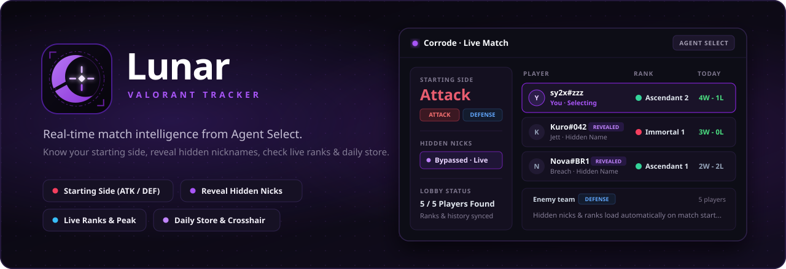

# Lunar

A VALORANT companion for Windows: profiles, match history, live lobby, friends, store and crosshairs. Requires .NET Framework 4.8 or later.

Join the Lunar Discord community: [discord.gg/hKuhHXHw9x](https://discord.gg/hKuhHXHw9x).

## Build and test

Run `powershell -ExecutionPolicy Bypass -File .\build.ps1` from this folder. The executable is `Lunar-1.79.exe` in this same folder. Run `Lunar-1.79.exe --self-test` for offline checks. Source changes and test executables are maintained directly in this Lunar folder.

For a new MSI, run `powershell -ExecutionPolicy Bypass -File .\build-installer.ps1`. The script detects WiX 3.11/3.14 automatically; `-WixPath` can override detection on build machines. `build.ps1` creates only the executable.

## Riot statistics session

Statistics now use the Riot client endpoints from the supplied `vava(1).py`, instead of HenrikDev. Tracker statistics reuse the signed-in Riot Client session automatically. No cookie, API key or token needs to be copied into Lunar. Sign in to Riot Client before searching. A legacy saved session is also supported. Lunar stores it with Windows DPAPI, scoped to the current Windows account, in `%APPDATA%\Lunar\riot-ssid.key`. No cookie or access token is embedded in the EXE or MSI. `LUNAR_RIOT_SSID` is an optional fallback environment variable when no saved cookie exists.

Lunar exchanges the cookie for access and entitlement tokens, discovers the account region, and renews tokens when necessary. A renewed cookie is saved encrypted. An expired or rejected cookie requires signing into Riot again and replacing the cookie through the search authentication dialog. The Riot Client session is read from the local client lockfile and entitlement endpoint, remains in memory only, and is reused for statistics requests. Lunar never displays or logs the token. The game does not need to be open for these statistics; Live Match, friends and store retain their existing local-client requirements.

Player lookup uses the aliases API; ranks use MMR; history and scoreboards use match-history and match-details. BR and LATAM use Riot's NA shard. Profiles are fetched in the authenticated account's region; cross-region data may be unavailable. Archive loading pages through the history Riot actually exposes; it is not HenrikDev's lifetime archive. Requests have timeouts, cancellation, bounded concurrency and rate-limit backoff. Completed match details are cached in memory. Pre-Ascendant peak ranks are normalized; the peak is an estimate from seasonal final ranks and wins by tier, as in the Python reference. Last-known ranks are labeled when the current act is unavailable.

Offline tests do not verify whether a particular Riot session or server permits live requests. A valid session is required for that check. Assets and client version metadata come from Valorant-API. Crosshair credits are in `assets/crosshairs.json`.

Profile loading requests ten recent competitive matches and rank concurrently. Extra history is loaded on demand. Individual unavailable matches retain placeholders without discarding successful records. Archive paging stops on the provider total or a short final page. A history 404 falls back to competitive updates; the UI identifies this limited source. Scoreboard names are fetched in one batch from Riot name-service when opening a match and cached in memory. Empty or inaccessible Riot data cannot be reconstructed by the client.

Account levels appear in the profile header, Live Match list and Alt+T overlay. Live identity levels take precedence. When absent, the latest available match level is used and the profile labels it as recent-match data. Numbers returned by Riot are displayed even when the in-game level display flag is hidden. When neither the live response nor recent matches provides a number, an em dash is displayed; values are never fabricated.

Summit uses the native Plummet map alias and its bundled image. Background history loading is limited to two profiles concurrently, with up to eight network requests, to reduce contention with interactive searches. The initial ten-match count is subject to the records actually available from Riot. Date headers such as Today still count only games played on that date.

Scoreboards show each player's account level recorded in that match. Map names, aliases and UUID resolution come from the bundled maps catalog (including canonical display names and native paths). Unrecognized map identifiers display Map unavailable rather than an internal code.

All statistics requests share one in-memory Riot session. Valid sessions use a lock-free read; initialization and renewal are serialized and checked again under the lock. Tokens are renewed on expiry, a changed login cookie, or a 401 response, not per player search. Diagnostic counters record session creation/reuse counts without logging credentials.

Deathmatch rosters use the full Live Match panel with a minimum row height and mouse-wheel scrolling on smaller windows. Rank requests run independently of the background history queue. Simultaneous match-detail requests recheck the shared cache under per-key synchronization to avoid downloading the same completed match repeatedly. Loading previews label pending account levels as loading.

Profile pages show a dedicated loading screen until the complete statistics result is ready; partial rank previews no longer expose an unfinished page. Existing completed cached profiles remain usable. Map filters follow the selected mode: standard maps for Competitive/Unrated/Swiftplay/Spike Rush/Deathmatch, dedicated arenas for Team Deathmatch, and their union for All modes. Training and practice maps are excluded.

The app checks the signed GitHub update feed every three hours. It verifies the publisher signature and executable SHA-256 before staging an update. When ready, an Update ready card appears at the lower right with an Update now button. Clicking it closes Lunar, atomically replaces the app executable in the background, and reopens Lunar; users do not browse for, download, or run an installer. Settings includes a saved English / Brazilian Portuguese selector and a configurable global hotkey for the live overlay. The MSI is only for first-time installation. The updater applies in place to the executable already being used. The MSI installs per user and does not need administrator privileges. Startup does not ask for a Riot session or any API key. Tracker data still requires the user's Riot session because no hosted stats service or provider key is configured in this project.

Tracker searches reuse a signed-in Riot Client session automatically and do not prompt for pasted credentials. The user still needs to be signed in to Riot Client for Riot to authorize profile requests.

## Publishing an update

Run `powershell -ExecutionPolicy Bypass -File .\release.ps1 -Version 1.80 -Notes "what changed"`. It sets the version, builds, runs the self-test, signs `lunar-update.json`, packs the executable as `Lunar-<version>.zip`, commits, pushes and creates the GitHub release `v<version>` in `mucalol640-glitch/Lunar`. No raw `.exe` and no `.msi` is uploaded to GitHub: the app downloads the zip, extracts the executable and verifies its signed SHA-256 before applying. The MSI (`build-installer.ps1`) is distributed separately and is installed only once.

Release signing uses an RSA private key protected with Windows DPAPI at %LOCALAPPDATA%\Lunar\update-signing.key. create-update-signing-key.ps1 creates a new signing identity once and updates UpdatePublicKey.xml; do not rerun it for routine releases. Build the executable and use sign-update.ps1 with that executable to create Output\lunar-update.json. Publish only the executable and signed manifest as update assets. MSI packages are reserved for first-time installation and are never part of app update releases. The private key is scoped to the current Windows account and must be backed up securely; losing it requires a one-time manual trust-key rotation.
