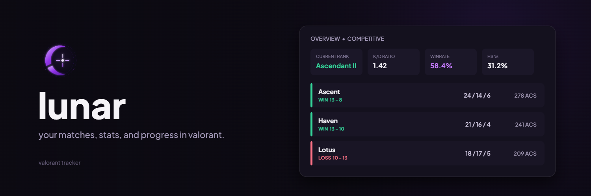

# Lunar

A Windows companion for VALORANT match history, live match stats, friends, the daily store, and crosshairs.

## Install

Download **Lunar-Setup** from [Releases](https://github.com/charlesproxy/Lunar/releases) and run it. Requires .NET Framework 4.8 or later.

On first launch, enter a HenrikDev API key to enable Tracker and live player statistics. Lunar encrypts the key for the current Windows account and stores it locally. The key is never included in the installer or source repository. Live Match also requires VALORANT to be running. Press **Alt + T** to toggle the overlay in windowed fullscreen.

## Build from source

Run `build.ps1` in PowerShell. For an MSI, run `build-installer.ps1 -WixPath <WiX 3.14 folder>`. Release builds can optionally use Obfuscar with `-ObfuscarPath <Obfuscar.Console.exe>`.

Assets are from [Valorant-API](https://valorant-api.com/). Crosshair credits are in [`assets/crosshairs.json`](assets/crosshairs.json).
